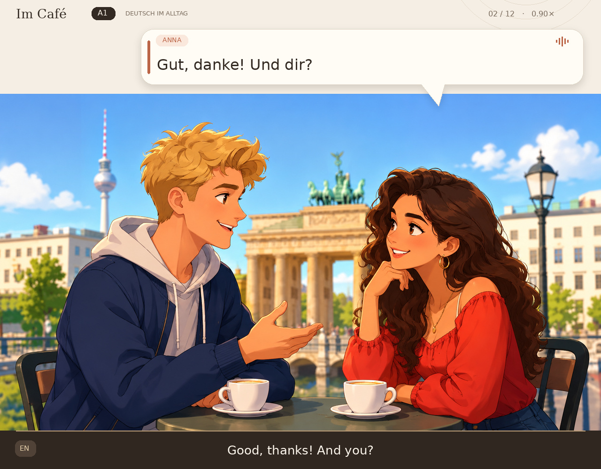

# German A1 café podcast

Generate a conversation video from `cafe_two_people.png`: Ben speaks on the left,
Anna on the right. Only the current speaker's bubble appears, with optional word-by-word
highlighting when using the Edge engine. English translations stay
in a separate bottom band. The illustration itself is static (no lip sync).

## Visual style

Warm cream and espresso framing, teal/coral speaker accents, name badges, subtle
shadows, shaped speech tails, and a dedicated English subtitle band. The header
shows the current turn and playback speed. Faces and the full café scene remain
visible.



## Included preview

The checked-in [updated video](samples/cafe-a1.mp4) and [audio](samples/cafe-a1.mp3)
contain all 12 turns, rendered with Eva and Thorsten. Local stream/duration checks and a full
FFmpeg decode passed. English and German subtitles are also in `samples/`.

## Episode production

Write one lesson as `input/<episode-id>.md`. Its YAML settings contain image_ready,
image path, level, voices, speed and duration target; the body contains dialogue,
translations and artwork prompts. The pipeline creates its internal JSON files.

With `image_ready: false`, the lesson waits. Upload its image into `images/`, set
`image_ready: true` and commit to render the complete lesson and publish it to R2.
GitHub artifact uploads are disabled. Verified public links are saved in
`published/<episode-id>.json`.

**[Production guide and secret names](docs/PRODUCTION.md)** ·
**[Long café script](input/cafe-visit-a1.md)** ·
**[Single-file template](input/_template.md)**

## Local voice test using the original demo

Requires Python 3.12, FFmpeg, and DejaVu Sans fonts. On Ubuntu:

```bash
sudo apt-get update
sudo apt-get install -y ffmpeg fonts-dejavu-core
python -m venv .venv
source .venv/bin/activate
pip install -r requirements.txt
python -m piper.download_voices --data-dir models de_DE-thorsten-medium
python scripts/download_silero.py
python -m unittest discover -s tests -v
python scripts/render_episode.py --sample
# Optional override: python scripts/render_episode.py --speed 0.90
python scripts/verify_output.py output/cafe
```

Remove `--sample` for the complete episode. Output: MP4 video, MP3 audio, WAV
master, separate German/English SRT subtitles, episode JSON, and a word-level
timeline JSON. The renderer uses 48 kHz mono audio, 24 fps video and 0.65-second
turn-taking pauses. Speech plays at 0.90× the previous preview, with pitch preserved.

## Voices and timing

Default `--engine auto` uses **Silero v3 German Eva (`eva_k`) for Anna**, producing
48 kHz speech, and Piper Thorsten for Ben. Anna's character name remains Anna.
The previous Kerstin voice and a Ramona candidate performed poorly in the German
ASR check and are not used for Anna in automatic mode. Voices are selected per
speaker in the episode JSON, and the timeline records the actual engine/voice.

Install the CPU dependencies, download both models, and render:

```bash
pip install -r requirements.txt
python -m piper.download_voices --data-dir models de_DE-thorsten-medium
python scripts/download_silero.py
python scripts/render_episode.py
```

The Silero downloader verifies a pinned SHA-256. It tries the official model URL
and a byte-identical mirror; no unverified model is loaded. Models run locally
after downloading. Anna uses Silero's native speaking cadence with the requested
0.90× pitch-preserving slowdown. Ben retains the earlier Piper 1.18 duration scale
and 0.90× playback. The subtitles follow measured audio durations.

**Silero attribution and license:** German v3 model by the
[Silero Team](https://github.com/snakers4/silero-models), licensed under
[CC BY-NC-SA 4.0](https://github.com/snakers4/silero-models/blob/master/LICENSE).
This preview uses Eva's voice and resamples/slows the generated speech. The model
is noncommercial; obtain appropriate commercial rights before using it in a
monetized product. Model files are downloaded separately. Piper is GPL-3.0;
Thorsten's dataset is CC0 according to its
[model card](https://huggingface.co/rhasspy/piper-voices/blob/main/de/de_DE/thorsten/medium/MODEL_CARD).

`--engine piper` explicitly selects the older Piper-only setup; it is retained for
comparison, not recommended for Anna. Optional `--engine edge` supports real
word-timestamp karaoke, but returned HTTP 403 in the tested environments and
remains experimental. Silero/Piper use sentence captions, not estimated karaoke.
No synthesis error silently changes Anna back to the old voice.

### Check the voice independently

The included [Anna-only audition](samples/anna-eva.mp3) isolates her six actual
turns from the rendered video. The [audit report](samples/voice-audit.json) records
Whisper-small's German transcription without a supplied transcript or prompt.
This measures word intelligibility; it cannot prove perfect pronunciation,
accent or naturalness. Human listening is still required.

```bash
pip install -r requirements-audit.txt
python scripts/audit_pronunciation.py output/cafe
```

Every turn is cached by text, voice and synthesis settings. Delete the output cache
to regenerate voices. Use `--speed` to override the episode's `playback_speed`.

## Editing the lesson

Edit the dialogue table in `input/<episode-id>.md`; keep Speaker, German and
English columns. Speaker names must match the two characters in the settings,
with one on the left and one on the right. The original `episodes/cafe_a1.json` is retained
for direct voice tests; the production workflow reads Markdown lessons in `input/`. Change `translation` to another language and
update `translation_language` if desired; font support must cover that language.
The current script is a deliberately short A1 café conversation: greetings,
coffee/tea, milk, cake, hunger and hot drinks. It uses present tense, basic questions,
`möchte` and common everyday vocabulary. `möchte` and accusative forms such as
`einen Tee` are standard beginner ordering phrases. It is a reviewed fixed script,
not unrestricted AI script generation. Structural checks cannot certify CEFR level;
review new scripts for vocabulary, grammar, pronunciation and translations.

### Episode transcript

| Speaker | German | English |
|---|---|---|
| Ben | Hallo, Anna! Wie geht es dir? | Hello, Anna! How are you? |
| Anna | Gut, danke! Und dir? | Good, thanks! And you? |
| Ben | Auch gut. Was möchtest du trinken? | Good too. What would you like to drink? |
| Anna | Ich möchte einen Tee, bitte. | I would like a tea, please. |
| Ben | Mit Milch oder ohne Milch? | With milk or without milk? |
| Anna | Ohne Milch. Und du? | Without milk. And you? |
| Ben | Ich nehme einen Kaffee mit Milch. | I will have a coffee with milk. |
| Anna | Möchtest du auch einen Kuchen? | Would you also like a cake? |
| Ben | Ja, bitte. Ich habe Hunger. | Yes, please. I am hungry. |
| Anna | Ich auch. Der Kuchen ist gut! | Me too. The cake is good! |
| Ben | Ist dein Tee heiß? | Is your tea hot? |
| Anna | Ja. Ich warte noch. | Yes. I will wait a little longer. |
