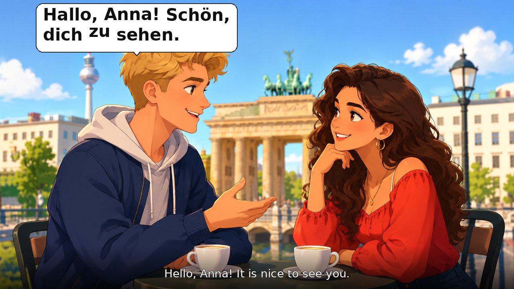

# German A1 café podcast

Generate a conversation video from `cafe_two_people.png`: Ben speaks on the left,
Anna on the right. Only the current speaker's bubble appears, with optional word-by-word
highlighting when using the Edge engine. English translations stay
in a separate bottom band. The illustration itself is static (no lip sync).

## Visual style

The current video uses a full 16:9 scene with simple white, dark-outlined speech
bubbles placed above the active character. German text is bold and wraps into
balanced lines. English subtitles sit over a soft fade at the bottom. There is
no top banner, title, level badge, sentence counter, speed display or name tag.



## Latest video

The latest R2 video, audio and thumbnail links are recorded in
[published/cafe-visit-a1.json](published/cafe-visit-a1.json). The checked-in
`samples/` files are older voice tests and retain their earlier layout.

## Episode production

Write one lesson as `input/<episode-id>.md`. Its YAML settings contain image_ready,
image path, level, voices, speed and duration target; the body contains dialogue,
translations and artwork prompts. The pipeline creates its internal JSON files.

With `image_ready: false`, the lesson waits. Upload its image into `images/`, set
`image_ready: true` and commit to render the complete lesson and publish it to R2.
GitHub artifact uploads are disabled. Verified public links are saved in
`published/<episode-id>.json`.

**[Production guide and secret names](docs/PRODUCTION.md)** ·
**[Long café script](input/cafe-visit-a1.md)** ·
**[Single-file template](input/_template.md)**

## Local voice test using the original demo

Requires Python 3.12, FFmpeg, and DejaVu Sans fonts. On Ubuntu:

```bash
sudo apt-get update
sudo apt-get install -y ffmpeg fonts-dejavu-core
python -m venv .venv
source .venv/bin/activate
pip install -r requirements.txt
python -m unittest discover -s tests -v
python scripts/render_episode.py --sample
# Optional override: python scripts/render_episode.py --speed 0.90
python scripts/verify_output.py output/cafe
```

Remove `--sample` for the complete episode. Output: MP4 video, MP3 audio, WAV
master, separate German/English SRT subtitles, episode JSON, and a word-level
timeline JSON. The renderer uses 48 kHz mono audio, 24 fps video and 0.65-second
turn-taking pauses. Speech plays at 0.90× the previous preview, with pitch preserved.

## Voices and timing

Default `--engine auto` uses **Edge TTS FlorianMultilingual for Ben**
(`de-DE-FlorianMultilingualNeural`) and **SeraphinaMultilingual for Anna**
(`de-DE-SeraphinaMultilingualNeural`), both German (Germany). Character names
and screen positions are independent of voice names. The Markdown file can
set an explicit `speakers` map; new lessons use these voices by default.

`playback_speed: 0.90` is sent to Edge as native `rate="-10%"` with the default
base `rate: +0%`. No second time stretch is applied. Word boundaries remain
available in the timeline; simple sentence bubbles remain the default. Set
`karaoke: true` to enable word highlighting. Every turn records its actual
engine and voice; synthesis failures never substitute an older voice.

Edge TTS requires access to Microsoft's online speech service. The workflow
uses edge-tts 7.3.1 and skips offline voice-model downloads for Edge episodes.
Speech is cached by text, exact voice, rate and library version.

Piper and Silero remain optional for comparison. If explicitly selecting them,
download the configured models first. **Silero attribution and license:** German
v3 model by the [Silero Team](https://github.com/snakers4/silero-models), licensed
under [CC BY-NC-SA 4.0](https://github.com/snakers4/silero-models/blob/master/LICENSE).
Historical Eva samples use this noncommercial model. Piper is GPL-3.0; Thorsten's
dataset is CC0 according to its
[model card](https://huggingface.co/rhasspy/piper-voices/blob/main/de/de_DE/thorsten/medium/MODEL_CARD).

### Check the voice independently

The included [Anna-only audition](samples/anna-eva.mp3) isolates her six actual
turns from the rendered video. The [audit report](samples/voice-audit.json) records
Whisper-small's German transcription without a supplied transcript or prompt.
This measures word intelligibility; it cannot prove perfect pronunciation,
accent or naturalness. Human listening is still required.

```bash
pip install -r requirements-audit.txt
python scripts/audit_pronunciation.py output/cafe
```

Every turn is cached by text, voice and synthesis settings. Delete the output cache
to regenerate voices. Use `--speed` to override the episode's `playback_speed`.

## Editing the lesson

Edit the dialogue table in `input/<episode-id>.md`; keep Speaker, German and
English columns. Speaker names must match the two characters in the settings,
with one on the left and one on the right. The original `episodes/cafe_a1.json` is retained
for direct voice tests; the production workflow reads Markdown lessons in `input/`. Change `translation` to another language and
update `translation_language` if desired; font support must cover that language.
The current script is a deliberately short A1 café conversation: greetings,
coffee/tea, milk, cake, hunger and hot drinks. It uses present tense, basic questions,
`möchte` and common everyday vocabulary. `möchte` and accusative forms such as
`einen Tee` are standard beginner ordering phrases. It is a reviewed fixed script,
not unrestricted AI script generation. Structural checks cannot certify CEFR level;
review new scripts for vocabulary, grammar, pronunciation and translations.

### Episode transcript

| Speaker | German | English |
|---|---|---|
| Ben | Hallo, Anna! Wie geht es dir? | Hello, Anna! How are you? |
| Anna | Gut, danke! Und dir? | Good, thanks! And you? |
| Ben | Auch gut. Was möchtest du trinken? | Good too. What would you like to drink? |
| Anna | Ich möchte einen Tee, bitte. | I would like a tea, please. |
| Ben | Mit Milch oder ohne Milch? | With milk or without milk? |
| Anna | Ohne Milch. Und du? | Without milk. And you? |
| Ben | Ich nehme einen Kaffee mit Milch. | I will have a coffee with milk. |
| Anna | Möchtest du auch einen Kuchen? | Would you also like a cake? |
| Ben | Ja, bitte. Ich habe Hunger. | Yes, please. I am hungry. |
| Anna | Ich auch. Der Kuchen ist gut! | Me too. The cake is good! |
| Ben | Ist dein Tee heiß? | Is your tea hot? |
| Anna | Ja. Ich warte noch. | Yes. I will wait a little longer. |

### Audio checks

All generated speech is processed in floating point, given peak headroom
without hard clipping, and faded for 5 ms at its boundaries before final
PCM conversion. `audio-quality.json` records per-turn clipping and boundary
checks. These technical checks do not certify pronunciation or perceptual quality.
