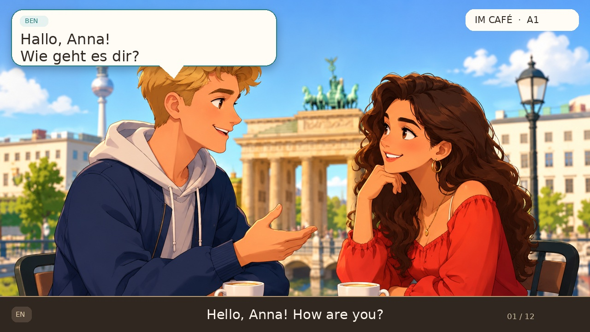

# Two-person German episode workflow

One folder is one episode. Keep the script, artwork references and prompts together.
The GitHub workflow discovers ready packages under `input/` and renders complete
episodes on `main`. It uses a four-turn preview for pull requests. The existing
`samples/` files remain reference previews; new output is delivered as workflow
artifacts and optionally to R2, without committing large generated videos to Git.

## Your normal process

1. Ask for an **A1 or A2 episode package**, with the topic, two characters,
   translation language and an 8–10 minute target. The package should contain the
   full `episode.json` and a `prompts.md` with scene and thumbnail prompts.
2. Put those files in `input/<episode-id>/`. Keep `ready: false` while preparing
   the image. Use a lowercase folder/id such as `cooking-with-mama-a1`.
3. Generate the scene using the supplied prompt. Upload it into that same folder
   as `background.png`. The two people must match the script's left/right positions.
4. Optionally generate a custom thumbnail. Save it as `thumbnail.png` and add
   `"thumbnail": "thumbnail.png"` inside the `assets` object. If omitted, the
   pipeline makes a titled cover from the background.
5. Set `ready: true` and commit. **Actions → German episode production** will
   render the full video, verify it, and provide a download for that episode.

You can commit all files together, or add the script first and images later.
Draft packages are skipped. A ready package with missing assets fails clearly.
The bundled `input/cafe-a1-demo/` is a short working example. `input/_template/`
is a draft blueprint: copy it to your chosen id and change its `id` to match.
The `input/_template/` folder itself is intentionally ignored.

## Package files

| File | Purpose |
|---|---|
| `episode.json` | German lines, translations, voices, character names, positions and playback settings |
| `background.png` | Your generated scene, with exactly two people and no captions |
| `prompts.md` | Scene prompt, thumbnail prompt, character continuity notes and lesson brief |
| `thumbnail.png` | Optional custom cover; used as supplied and resized to 1280×720 |

Artwork can also be reused from another location in the repository by changing
`assets.background`. Relative paths are resolved from the episode folder; assets
outside the repository are rejected. Updating a shared image rebuilds affected
ready packages. Normal use is simplest with the image beside the script.

## Supported script instructions

These are declarative JSON settings, not shell commands or executable hooks.
Do not put API keys or R2 credentials in an episode file.

| Field | Example | Meaning |
|---|---|---|
| `id` | `cooking-with-mama-a1` | Must match the folder name |
| `ready` | `false` then `true` | Controls when generation starts |
| `title` | `Kochen mit Mama` | Episode title |
| `display_title` | `In der Küche` | Optional shorter title for the video header |
| `level` | `A1` or `A2` | Lesson label and caption-length limits |
| `playback_speed` | `0.90` | Pitch-preserving playback multiplier |
| `pause_seconds` | `0.65` | Pause between caption turns |
| `target_duration_seconds` | `[480, 600]` | Desired 8–10 minutes; actual duration appears in the report |
| `thumbnail_title` | `Kochen mit Mama` | Title for the automatic fallback cover |
| `assets.background` | `background.png` | Required scene image |
| `assets.thumbnail` | `thumbnail.png` | Optional custom thumbnail |
| `speakers.<id>.position` | `left` or `right` | One character on each side; controls the bubble tail |
| `speakers.<id>.name` | `Mama` | Visible character name |
| `speakers.<id>.engine` | `silero` or `piper` | Speech engine for that character |
| `speakers.<id>.silero_voice` | `eva_k` | Tested German female voice |
| `speakers.<id>.piper_voice` | `de_DE-thorsten-medium` | Tested German male voice |
| `lines[].speaker` | `mother` | Must match one of the two speaker ids |
| `lines[].de` | `Was kochen wir heute?` | German caption and speech |
| `lines[].translation` | `What are we cooking today?` | Bottom subtitle |

Exactly two characters are required, but their ids/names need not be `male` and
`female`. For example use `mother` and `son`, assign positions, and select voices.
Only Eva and Thorsten have been tested here; a different voice requires its model
and listening review. An image cannot make a voice sound younger or older.

A1 captions allow at most 12 German words; A2 allows 18. These are layout limits,
not CEFR certification. Break longer speeches into short caption turns from the
same speaker. The script writer must review grammar, vocabulary and translation.
The level badge now follows the episode instead of being fixed to A1.

## Writing an 8–10 minute lesson

Build a small story rather than a long list of questions. For cooking: deciding
what to eat → finding ingredients → washing and cutting → cooking → tasting →
eating and cleaning up. Keep exactly two speaking characters. Recycle useful
phrases naturally as the task changes, with brief reactions and questions.

There is no single word count that guarantees ten minutes. Voice, punctuation,
speed and pauses all affect duration. Generate a draft, read
`production-report.json`, and revise the dialogue if necessary. A target miss is
reported; the system does not pad silence or repeat the script to force the length.
The short café demonstration intentionally uses a 25–60 second target.

## Deliverables

Each episode download contains:

- `podcast.mp4`, `podcast.mp3`, and `thumbnail.png`;
- German and translated SRT files;
- resolved `episode.json`, original `source.json`, and optional `prompts.md`;
- `timeline.json` with real turn/word timing where supported;
- `production-report.json` with measured duration and target comparison;
- `manifest.json` with the commit revision, file sizes and SHA-256 hashes;
- `r2-upload.json` when a complete upload succeeds.

A local WAV master and synthesis cache remain in the output folder, but are not
included in the R2 delivery manifest. The thumbnail is either your custom artwork
or a deterministic cover from the background; this pipeline does not call an
image-generation service.

## Optional R2 storage

Create your bucket and an R2 S3 credential with access to that bucket, then add
these **GitHub repository Actions secrets**:

| Secret | Value |
|---|---|
| `R2_ACCOUNT_ID` | Your 32-character Cloudflare account id |
| `R2_ACCESS_KEY_ID` | R2 S3 access key id |
| `R2_SECRET_ACCESS_KEY` | R2 S3 secret access key |
| `R2_BUCKET_NAME` | Existing destination bucket |

No credentials: upload is skipped and GitHub artifacts remain available for
30 days. Partial credentials: the job reports a configuration error. With all
four credentials, a complete main-branch render uploads its deliverables under:

`episodes/<episode-id>/<git-commit-sha>/<run-id>-<attempt>/`

The manifest is published last, after file transfers and size checks, so it acts
as the completion marker. Each run has its own version, including reruns of the same commit; no mutable `latest`
pointer is maintained. R2 upload is never performed for pull requests or short
sample renders. A failed upload fails the job, while the verified GitHub artifact
is still retained. Real R2 transfer testing remains pending until credentials are
supplied; local tests use a storage double and make no cloud writes.

Optionally set a repository **variable** `R2_PUBLIC_BASE_URL` to an already
configured public bucket domain. The upload report can then include a video URL.
Setting this variable does not make a private bucket public. Without a public
domain, the report gives the bucket/object keys for private access.

References: [Cloudflare R2 boto3 examples](https://developers.cloudflare.com/r2/examples/aws/boto3/)
and [S3 API setup](https://developers.cloudflare.com/r2/get-started/s3/).

## Manual rendering and reruns

```bash
python scripts/discover_episodes.py
python scripts/produce_episode.py --episode input/cafe-a1-demo/episode.json
python scripts/produce_episode.py --episode input/cafe-a1-demo/episode.json --sample
python scripts/upload_r2.py output/cafe-a1-demo
```

For local R2 uploads, set `GITHUB_SHA` to the committed source revision before
rendering. Local manifests marked `local` are deliberately rejected for upload.
On GitHub, **Run workflow** accepts an episode id; blank selects all ready
packages. Source/renderer changes rebuild all ready packages; episode edits
rebuild only affected packages. Each job has its own output/artifact and a
60-minute timeout. Voice models and per-turn speech are cached between runs.

## Layout direction



Keep the current warm palette, character illustration, speaker names and bottom
translation strip. Suggested next visual iteration, in priority order:

1. Test a proper 16:9 composition with compact speech bubbles closer to each
   person's face, keeping both faces unobstructed and subtitles in a safe band.
2. Add a subtle active-speaker outline and a short bubble transition. Avoid
   blinking, constant zooming, or motion behind text during long lessons.
3. Make German text the strongest visual element; keep the English subtitle
   smaller but readable on a phone. Test A2's longer sentences before shrinking text.
4. Add optional short chapter cards and a closing vocabulary recap. These are
   proposed presentation features, not implemented pipeline commands yet.

The current approved layout remains the default. A 16:9 redesign deserves a
separate visual preview before replacing it. Word karaoke should only be enabled
with trustworthy timings; Eva currently uses synchronized sentence captions.

## Voice licensing before commercial release

Eva's Silero model is licensed CC BY-NC-SA 4.0. The current implementation is a
working noncommercial preview. Before monetization or commercial deployment,
obtain appropriate rights or replace Eva with a commercially licensed German
voice and repeat the listening/intelligibility checks. Attribution and model
links are in the main README.
